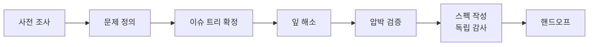
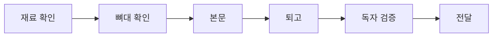

<p align="center">
  
</p>

<h1 align="center">태산 · 泰山 · taesan</h1>

<p align="center"><b>티끌 모아 태산</b></p>

<p align="center">
  AI 에이전트와 일하면서 만든 스킬, 에이전트, 그 밖의 도구를 하나씩 쌓아 두는 곳
</p>

---

## 태산이라는 이름

**태산(泰山)** 은 크고 높은 산을 뜻합니다. 원래는 중국 산둥성에 있는 산의 이름이지만, 우리말에서는 "걱정이 태산 같다", "갈 길이 태산이다"처럼 아주 크고 많은 것을 가리키는 말로 쓰입니다.

이 이름에는 두 가지 뜻을 담았습니다.

**하나, 작은 것이 쌓여 큰 것이 된다.**

> 티끌 모아 태산

여기 올라오는 스킬 하나, 에이전트 하나는 티끌만 한 도구입니다. 하나로는 대단하지 않아도, 쓸 만한 것을 꾸준히 모으면 산이 됩니다. 위 그림의 산도 가까이서 보면 전부 점입니다.

**둘, 큰 것도 오르다 보면 오를 수 있다.**

> 태산이 높다 하되 하늘 아래 뫼이로다<br>
> 오르고 또 오르면 못 오를 리 없건마는<br>
> 사람이 제 아니 오르고 뫼만 높다 하더라
>
> — 양사언

막막해 보이는 일도 결국 하늘 아래에 있는 산입니다. AI 에이전트는 그 산을 오르는 걸음을 훨씬 가볍게 만들어 줍니다. 이 레포는 그 걸음을 돕는 도구들의 모음입니다.

## 구성

| 폴더 | 내용 |
|---|---|
| [`skills/`](skills) | Claude Code 등에서 쓰는 에이전트 스킬 (SKILL.md 형식) |

에이전트 정의 등 다른 종류는 생기는 대로 폴더를 추가합니다.

## 스킬

### 🎙️ [taesan-interview](skills/taesan-interview)

막연한 아이디어나 작업 요청을 인터뷰로 파고들어, **AI 에이전트가 추가 질문 없이 실행할 수 있는 스펙 파일**로 만듭니다.

인터뷰형 도구가 흔히 겪는 세 가지 실패를 막도록 설계했습니다.

| 흔한 실패 | 이 스킬의 장치 |
|---|---|
| 질문이 얕고 뻔하다 | 조사로 알 수 있는 건 묻지 않고, 가설을 먼저 내놓은 뒤 그것이 틀릴 수 있는 지점을 묻습니다 |
| 언제 끝나는지 모른다 | 정해야 할 것을 이슈 트리로 먼저 보여주고, 해소될 때마다 진행률을 갱신합니다 |
| 결과물이 안 쓰인다 | 대화를 보지 못한 에이전트가 스펙만 읽고 막히는 지점을 감사한 뒤에 확정합니다 |

**진행 흐름**



**인터뷰 중에 보이는 진행률**

```
이슈 트리  [7/12 해소]
├─ ✅ 문제
├─ ✅ 성공 기준
├─ 🔶 범위
│   ├─ ✅ 포함
│   └─ ⬜ 제외  ← 다음
├─ ⬜ 리스크
└─ ✅ 제약
＋ 추가: 기존 데이터 이전 (이유: "기존 사용자 유지" 답변에서 파생)
```

**그 밖의 특징**

- 깊은 질문은 한 번에 하나씩, 빠르게 정해도 되는 결정은 추천안과 함께 묶어서 묻습니다.
- 여러 사람이 얽힌 일이면 이해관계자마다 에이전트를 하나씩 띄워 각자의 관점에서 반문하게 합니다.
- 스펙의 모든 결정에 출처(사용자 확정 / 인터뷰어 제안 / 조사)를 붙여, 실행하는 에이전트가 추정과 확정을 구분할 수 있습니다.
- 중간에 그만하자고 하면 남은 항목을 가정으로 적고 바로 마무리합니다.

**설치**

```bash
git clone https://github.com/HSUNEH/taesan.git
cp -r taesan/skills/taesan-interview ~/.claude/skills/
```

Claude Code에서 `/taesan-interview`를 입력하거나 "나랑 인터뷰하면서 구체화하자"처럼 요청하면 실행됩니다.

<details>
<summary><b>참고한 것</b></summary>

<br>

| 출처 | 가져온 것 |
|---|---|
| [Q00/ouroboros](https://github.com/Q00/ouroboros) | 사실과 결정의 분리, 되말하기 |
| [prekuter/dryforge](https://github.com/prekuter/dryforge) | 열거와 질문의 분리, 질문의 근거 요건, 독립 감사 |
| [obra/superpowers](https://github.com/obra/superpowers) | 왜를 알기 전에는 열린 질문, 출처 구분 |
| [mattpocock/skills](https://github.com/mattpocock/skills) | 선행 결정이 끝난 질문만 묶어 묻기 |
| [garrytan/gstack](https://github.com/garrytan/gstack) | 전제 확인, 입장을 가진 인터뷰어 |
| [github/spec-kit](https://github.com/github/spec-kit) | 질문마다 왜 묻는지 밝히기 |
| 맥킨지식 문제 해결 | 문제 정의, MECE 이슈 트리, 가설 주도 접근 |

</details>

### ✍️ [taesan-writing](skills/taesan-writing)

**논리가 서 있고 AI가 쓴 티가 나지 않는** 한국어 글을 씁니다. 주장하는 글, 업무 문서, 기술 문서, 영상 대본을 다룹니다.

AI 티의 대부분은 할 말이 없는 자리를 형식으로 메울 때 생깁니다. 그래서 표현을 고치기 전에 논리부터 채웁니다.



**쓰기 전에 보여주는 뼈대**

```
결론: 인터뷰 도구는 남은 분량이 보여야 끝까지 쓰인다
범위: 질문이 열 개를 넘는 인터뷰에 한해
├─ 근거 1: 끝을 모르면 중간에 그만둔다
│   ├─ 증거: 근거 필요
│   └─ 연결: 그만두는 이유가 내용이 아니라 분량 때문이어야 한다
├─ 근거 2: ...
└─ 반론: 트리를 먼저 그리면 인터뷰가 틀에 갇힌다
    └─ 답: 새 가지는 알리고 추가한다
```

| 장치 | 하는 일 |
|---|---|
| 뼈대 먼저 | 결론 한 문장, 근거, 증거, 반론을 쓰기 전에 확인받습니다. 증거와 근거 사이에 숨은 전제를 한 줄로 적어 구멍을 찾습니다 |
| 지어내지 않음 | 수치와 사례가 없으면 `근거 필요`로 표시하고 묻습니다. 주장의 세기와 확정된 정도를 바꾸지 않습니다 |
| AI 티 점검 | 내용 없는 문장, 빈자리를 메우는 문구, 틀에 박힌 수사, 번역투, 유보 겹치기, 리듬, 서식. 한 번만 나와도 고칠 것과 몰려 있을 때만 고칠 것을 나눕니다 |
| 설득 | 근거가 약한 기법과 조작에 해당하는 기법은 쓰지 않습니다. 대조나 셋으로 묶기처럼 수사법이 AI 티와 겹칠 때의 기준을 둡니다 |
| 독자 검증 | 초안도 뼈대도 보지 못한 에이전트가 글을 읽고, 무슨 말로 읽혔는지와 어디서 막혔는지 보고합니다 |

**설치**

```bash
git clone https://github.com/HSUNEH/taesan.git
cp -r taesan/skills/taesan-writing ~/.claude/skills/
```

Claude Code에서 `/taesan-writing`을 입력하거나 "이 주제로 글 써줘", "이 글 다듬어줘"처럼 요청하면 실행됩니다.

<details>
<summary><b>참고한 것</b></summary>

<br>

| 출처 | 가져온 것 |
|---|---|
| [toss/technical-writing](https://github.com/toss/technical-writing) | 문서 유형, 정보 구조, 문장 다듬기의 원칙 |
| [epoko77-ai/im-not-ai](https://github.com/epoko77-ai/im-not-ai) | 한국어 AI 티 패턴 분류, 고치다가 새 패턴을 심지 않는 가드 |
| [blader/humanizer](https://github.com/blader/humanizer) | 신호의 세기 구분, 정당한 용법의 예외 |
| [byungjunjang/slop-rewrite](https://github.com/byungjunjang/slop-rewrite) | 새 사실 금지와 확정 수준 보존, 접속사 삭제 시험, 제목에 판단 담기 |
| [nerdkim/korean-rewrite](https://github.com/nerdkim/korean-rewrite) | 영어 역번역 시험, 빠진 중간 단계 검사 |
| [anthropics/skills](https://github.com/anthropics/skills) | 독자 질문을 미리 적어 두고 대조하는 검증 |
| [Wikipedia: Signs of AI writing](https://en.wikipedia.org/wiki/Wikipedia:Signs_of_AI_writing) | 믿을 수 없는 지표, 사람 글의 표지 |
| Minto, Toulmin | 피라미드 구조, 숨은 전제 드러내기 |
| O'Keefe & Hoeken (2021) | 설득 기법의 효과 크기 종합 |

원칙만 참고해 새로 썼고, 원문의 문장과 예시는 옮기지 않았습니다.

</details>

---

<p align="center"><sub>오르고 또 오르면 못 오를 리 없건마는</sub></p>
